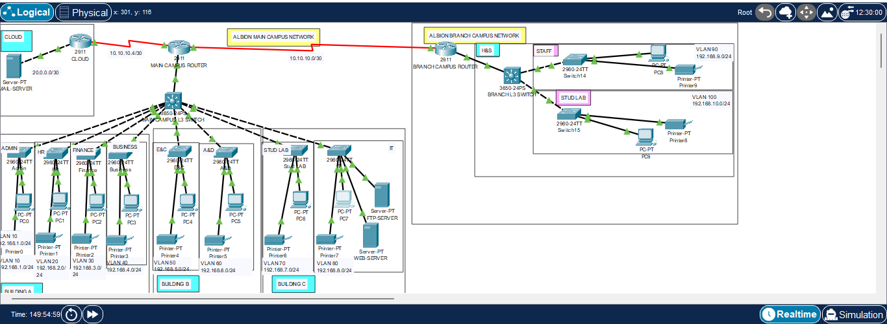

# University Campus Network: Design and Implementation

A two-campus enterprise network for a fictional university (a published practice brief), built in Cisco Packet Tracer. The main campus has three buildings and eight departments; the smaller campus 20 miles away has two. RIPv2 shares routes between the campuses, and a static route reaches an email server hosted outside the network.

**Built by:** Jahslove Ukpong  
**Date:** November 2026  
**Tool:** Cisco Packet Tracer (2911 routers, 3650-24PS multilayer switches, 2960-24TT access switches)



## The brief, in short

- **Main campus**
  - Building A: Management/Admin, HR and Finance staff, plus the Faculty of Business
  - Building B: Faculty of Engineering and Computing, and Faculty of Art and Design
  - Building C: student labs and the IT department, which hosts the web server and other servers
  - An email server hosted externally in the cloud
- **Smaller campus:** the Faculty of Health and Sciences, with staff and student labs on separate floors
- **Requirements**
  - Every department/faculty on its own IP network
  - Switches configured with VLANs and security settings
  - RIPv2 for the internal routers, static routing for the external server
  - Building A devices get their addresses from a router-based DHCP server

## Addressing plan

| Campus | Building | Department | VLAN | Network | Gateway |
| --- | --- | --- | --- | --- | --- |
| Main | A | Admin | 10 | 192.168.1.0/24 | 192.168.1.1 |
| Main | A | HR | 20 | 192.168.2.0/24 | 192.168.2.1 |
| Main | A | Finance | 30 | 192.168.3.0/24 | 192.168.3.1 |
| Main | A | Business | 40 | 192.168.4.0/24 | 192.168.4.1 |
| Main | B | Engineering & Computing | 50 | 192.168.5.0/24 | 192.168.5.1 |
| Main | B | Art & Design | 60 | 192.168.6.0/24 | 192.168.6.1 |
| Main | C | Student Labs | 70 | 192.168.7.0/24 | 192.168.7.1 |
| Main | C | IT (web and FTP servers) | 80 | 192.168.8.0/24 | 192.168.8.1 |
| Branch | H&S | Staff | 90 | 192.168.9.0/24 | 192.168.9.1 |
| Branch | H&S | Student Labs | 100 | 192.168.10.0/24 | 192.168.10.1 |

| Link | Network | Addresses |
| --- | --- | --- |
| Main campus router to branch campus router (serial) | 10.10.10.0/30 | .1 main, .2 branch |
| Main campus router to cloud router (serial) | 10.10.10.4/30 | .5 main, .6 cloud |
| Cloud router to email server | 20.0.0.0/30 | .1 gateway, .2 server |

## How it was built

### 1. Power up the multilayer switches

In Packet Tracer the 3650-24PS ships without a power supply. Open the Physical tab, drag in the AC power supply module, and the switch boots.

### 2. Access switches: one department per switch

Each 2960 serves one department, so all its ports are access ports in that department's VLAN, including the uplink.

```
interface range fa0/1-24
 switchport mode access
 switchport access vlan 10
```

### 3. Distribution: the 3650 multilayer switch

Each downlink to an access switch is an access port in the matching VLAN. The uplink to the router is a trunk that carries all eight VLANs.

```
interface gig1/0/2
 switchport mode access
 switchport access vlan 10
interface gig1/0/1
 switchport mode trunk
```

Two things I learned here:

- **`switchport trunk encapsulation dot1q` is rejected on the 3650.** Older multilayer switches such as the 3560 support two trunking protocols (ISL and 802.1Q), so you must choose one before setting trunk mode. The 3650 only supports 802.1Q, so there's nothing to choose and the command doesn't exist.
- **`%CDP-4-NATIVE_VLAN_MISMATCH` warnings** appeared while I was configuring. CDP compares the untagged VLAN on each end of a link. The access switch end was already in its department VLAN (for example 20), while the 3650 end was still in VLAN 1. The warnings stopped once both ends matched.

### 4. Inter-VLAN routing and DHCP on the routers

Each campus router has a subinterface per VLAN on its link to the 3650. Each subinterface is that department's default gateway, and the DHCP pools point clients to it.

```
interface gig0/0.10
 encapsulation dot1Q 10
 ip address 192.168.1.1 255.255.255.0

ip dhcp pool admin-pool
 network 192.168.1.0 255.255.255.0
 default-router 192.168.1.1
```

The brief only requires DHCP in Building A; I gave every VLAN a pool, so all PCs and printers get their addresses automatically.

### 5. Serial links between the routers

The DCE end of each serial cable sets the clock (`clock rate 64000`); without it the line protocol stays down.

### 6. RIPv2 between the campuses

```
router rip
 version 2
 network 10.0.0.0
 network 192.168.1.0
 ...
 network 192.168.8.0
```

RIP `network` statements are classful, so `network 10.10.10.0` and `network 10.10.10.4` are both stored as `network 10.0.0.0`.

### 7. The external email server

The email server sits behind its own router with a static address (20.0.0.2/30, gateway 20.0.0.1), as if hosted by an outside provider. The brief asks for static routing to reach it rather than RIP.

## RIPv2 vs OSPF: why the brief uses RIPv2

**Plain-language version:** RIP is like asking for directions by word of mouth. Every 30 seconds each router tells its neighbours everything it knows ("Business is 2 stops from me"), and the route with the fewest stops wins, even if one of those stops is a slow road. OSPF is like every router holding the same full city map, with road speeds marked, and working out the fastest route itself.

| | RIPv2 | OSPF |
| --- | --- | --- |
| Type | Distance vector: trusts what neighbours report | Link state: each router builds a full map of the network |
| Best route chosen by | Hop count (number of routers) | Cost, based on link bandwidth |
| Size limit | 15 hops; 16 = unreachable | No hop limit; areas let it scale |
| Updates | Whole routing table every 30 seconds | Small hellos every 10 seconds; full updates only when something changes |
| Recovery after a failure | Slow (timers of up to several minutes) | Fast |
| Administrative distance | 120 | 110 |
| Setup | Very simple | More planning (areas, router IDs, costs) |
| Fits | Small, simple networks; labs | Medium to large networks that will grow |

**Why RIPv2 here:** the network has only three routers and the longest path is two hops, so RIPv2's limits don't bite, and it's quick to configure and easy to verify. RIPv2 (not v1) is the minimum acceptable choice: it sends the subnet mask with every route (classless), supports VLSM and authentication, and uses multicast (224.0.0.9) instead of broadcasting. Most likely the brief also wants students to learn RIP.

**What I'd recommend for a real university:** OSPF. The 20-mile link between campuses will be much slower than the links inside a campus. RIP can't see that because it only counts hops, while OSPF's cost metric can. OSPF also recovers from failures faster and scales as more buildings are added.

## Verification

| Test | Result | What it proves |
| --- | --- | --- |
| PC0 (Admin, 192.168.1.x) to 192.168.7.2 (Student Labs) | Replies, TTL=127 | Inter-VLAN routing works; the packet crossed one router (128 − 1) |
| PC7 (IT, main campus) to 192.168.9.2 and 192.168.10.2 (branch campus) | Replies, TTL=126 | RIPv2 carries routes between campuses; two routers crossed |
| PC8 (branch Staff) to 192.168.4.2 (Business, main campus) | Replies, TTL=126 | Same, in the other direction |
| PC8 to 10.10.10.2 (branch router serial interface) | Replies, TTL=255 | Routers start their replies at TTL 255; PCs start at 128 |
| Email server to 20.0.0.1 (its gateway) | Replies | The external segment is up |

In several tests the first ping timed out and the rest succeeded. That first packet waited for ARP to resolve the next-hop MAC address.

## Design evaluation

**Performance.** Each campus uses router-on-a-stick: every inter-VLAN packet goes up one gigabit trunk to the router and back down. With eight VLANs on the main campus that single link is the bottleneck. The 3650s can route between VLANs themselves at wire speed (`ip routing` plus an SVI per VLAN), which would remove the bottleneck; in this build they act as Layer 2 distribution switches.

**Scalability.** New departments are easy to add: a VLAN, a subinterface, a DHCP pool and a RIP network statement. RIPv2's 15-hop limit and periodic full-table updates will hurt as the university grows, which is the main argument for OSPF.

**Reliability.** There are single points of failure everywhere: one router per campus, one 3650 per campus, one uplink per access switch and one serial link between campuses. Redundant uplinks (with STP or EtherChannel), a second inter-campus link, and HSRP for the gateways would fix the worst of these.

**Security.** VLANs separate departments' broadcast traffic, but nothing yet stops one department reaching another. Recommended next steps: ACLs (for example, students can reach the web server but not Finance), port security on access ports, shutting down unused ports, SSH-only device management with `enable secret`, and `passive-interface` so RIP updates aren't sent toward user VLANs or the external network.

## What I'd improve in version 2

- **Use the 3650s as real Layer 3 switches.** Enable `ip routing`, create an SVI per VLAN as the gateway, make the router link a routed port, use `ip helper-address` to reach the DHCP server, and run RIP (or OSPF) on the switch.
- **Building A on shared switching.** The brief hints that admin departments share networking equipment, so one or two switches carrying several VLANs over a trunk would show VLAN segmentation better than one switch per department.
- **Complete the static routing to the email server.** On the main router, add `ip route 20.0.0.0 255.255.255.252 10.10.10.6` and `redistribute static` under RIP so the branch learns it too. Give the cloud router a route back, such as `ip route 0.0.0.0 0.0.0.0 10.10.10.5`. Then test from both campuses.
- **RIP hygiene.** Add `no auto-summary`, and `passive-interface` on the LAN subinterfaces and the link to the cloud.
- **Switch security.** Port security, unused ports shut down and moved to a parking VLAN, SSH, and hostnames on every device.
- **DHCP.** Excluded addresses for gateways, servers and printers, and either a real DNS server or no `dns-server` option.

## Files

- `screenshots/` topology, configuration and test screenshots
- `configs/` configurations reconstructed from the CLI screenshots (see the note there)
